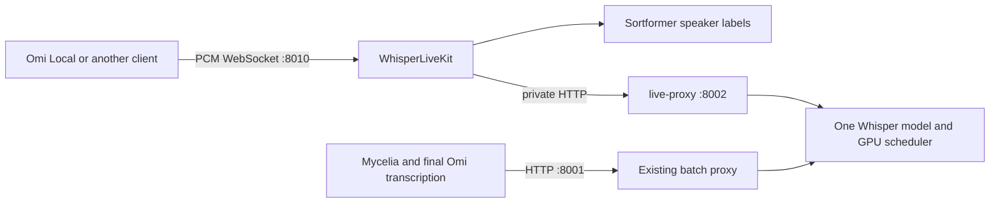

# Shared Whisper and WhisperLiveKit

This optional deployment keeps the current file transcription API and model,
and adds one live stream for Omi Local or another WLK-compatible client.
It is independent of Mycelia's database and of the final Pyannote diarizer.



## Contracts and limits

- File clients retain `/v1/audio/transcriptions`, the existing bearer key,
  model `large-v3-turbo` (or alias `whisper`), language/prompt, segments and
  optional word timestamps. The public proxy does not assign live priority.
- Live clients use `/asr`, binary little-endian PCM16, mono 16 kHz. The first
  config declares `useAudioWorklet`, `diarization`, and `stt_provider`. Clients
  replace their transcript from full snapshots; earlier lines can be revised.
  Send an empty binary frame and wait for `ready_to_stop` before closing.
- WLK uses LocalAgreement and its remote OpenAI-compatible backend. The name
  describes the protocol; the required base URL points at the private
  `live-asr` Docker service. It does not call OpenAI or load Whisper weights.
- Sortformer is an additional model. It distinguishes up to four anonymous
  speakers in one session. WLK assigns one speaker per frame/token, including
  overlapping speech; labels are provisional and do not identify people.
- Only one simultaneous live stream is accepted. File work retains native
  complete-file context. GPU operations cannot be interrupted, but the next
  operation is selected with weighted 4:1 live/batch fairness when both wait.
- Requests have bounded admission/deadlines. Cancellation releases their model
  lease after the current GPU operation. Idle offload waits for all accepted
  work, including suspended file generators, to finish.

## Deployment

Use the existing STT project name and its current environment. Preserve the
current cache volume and proxy key. For an existing Portainer-managed stack,
update that stack's canonical definition with the rendered overlay rather than
leaving an older definition that would undo the release on the next update.
Do not print rendered configuration: it contains environment secrets.
Set `WHISPER_CACHE_VOLUME` to the existing Whisper container's cache volume
(on faeon: `mycelia-stt_whisper-cache`); the overlay requires this explicitly.
Also set `ASR_QUANTIZATION` to the current precision (`float16` on faeon).

Create a private `sky-audio` Docker network once. On faeon, the automatic Docker
address pool is exhausted; use the checked nonoverlapping subnet when creating
this network, if it does not already exist:

```bash
docker network create --driver bridge --subnet 10.250.81.0/28 sky-audio
```

Save a newly generated
`LIVE_ASR_TOKEN` in the deployment's protected environment file, distinct from
the batch key and WLK's client-facing token. The private adapter has no published
host port. Only WLK joins its shared network; Whisper stays in the STT network.

From the checkout on the GPU host, prepare immutable image tags and validate:

```bash
docker compose --env-file /path/to/protected-stt.env -p mycelia-stt \
  -f gpu/docker-compose.portainer.yml -f gpu/docker-compose.shared-live.yml \
  config --quiet
docker compose --env-file /path/to/protected-stt.env -p mycelia-stt \
  -f gpu/docker-compose.portainer.yml -f gpu/docker-compose.shared-live.yml \
  build whisper proxy live-proxy
```

Build/start WLK with the separate definition in [livekit](livekit/). Bind port
8010 to the host's Tailscale address and use `Authorization: Bearer` with the
WLK token. `WLK_LANGUAGE` defaults to `auto`; set a fixed language only when
the workload requires it. Store model cache as external `sky-livekit_wlk-cache` on the existing
deployment. Never run the old `omiloc-docker-wlk-1` and the standalone service
together. Remove the WLK include/dependency from the former combined Compose
definition after preserving a rollback copy; stopping Omi must not stop the
shared service.

Before replacing Whisper, drain accepted requests and confirm its scheduler
reports no active work. The upgraded server provides authenticated
`POST /scheduler/drain` and `/scheduler/resume`; `GET /scheduler` reports
technical status. These are internal endpoints, not the public proxy API.
For the initial stock-server cutover, wait for current requests to finish and
briefly stop new proxy admissions before replacement. Retain previous images,
Compose files, environment and volumes for rollback. Recreate only affected
services; no database or Redis restart is required.

## Omi Local in Docker

In the local library settings, use the existing provider workflow:

1. Live STT: `external`, `ws://<Tailscale-IP>:8010/asr`, new WLK token.
2. Final transcription: `openai-compatible`,
   `http://<Tailscale-IP>:8001/v1`, model `large-v3-turbo`, existing proxy key.
3. For each card, check, save, and activate while capture/final processing is
   idle. Keep old provider cards for rollback. Tokens belong in the private
   provider secret store; never embed them in URLs.
4. After activating external final transcription and confirming capture and
   processing are idle, run `./docker.sh down` to stop the old stack without
   deleting its volumes. Start with `OMI_DOCKER_STT=external ./docker.sh up`
   (or `OMI_DOCKER_STT=external ./docker.sh tailscale up` for the paired
   transport). Keep `OMI_DOCKER_STT=external` in the invocation environment for
   future `up`, `down`, `status`, and `logs` commands; the wrapper defaults to
   built-in STT when this shell variable is absent. Preserve the existing
   transport configuration and state volume.

Live speaker labels do not require enabling Omi's separate final diarization
provider. This release does not activate a stopped Mycelia Pyannote service or
add a live recording interface to Mycelia.

The deployed September 16 Omi image exposed two local bottlenecks during replay:
a 60-second backend-import budget and durable capture metadata writes on every
20 ms frame. The guarded [Omi compatibility image](omi/README.md) extends that
budget and checkpoints metadata once per second while preserving PCM writes,
final fsync and crash recovery. It builds from the saved deployed image and
does not copy an unrelated dirty Omi checkout. When using this image, retain
its third Compose override for future app starts; plain `docker.sh up` rebuilds
the standard Omi image. It also retries a timed-out Firestore owner-profile
read during cold startup, because an open emulator port is not sufficient
readiness. Recreate only `app` after capture and import work stop.

## Verification

The [2026-10-23 stability follow-up](VERIFICATION-2026-10-23.md) records the
completed 30-minute direct replay, concurrent file requests, cancellation and
idle-resume checks, the deployed image and remaining continuous-session limits.
The [October 1 report](VERIFICATION-2026-10-01.md) retains the earlier failed
soak and initial Omi integration evidence.

Run focused offline tests from the repository root with an isolated environment:

```bash
uv run --with pytest --with-requirements gpu/proxy/requirements.txt \
  pytest gpu/proxy/tests
```

Also run the scheduler and WLK tests documented in their directories. Validate
Compose before startup. Health proves process availability; actual audio proves
ASR and diarization. Before/after checks must use a real authenticated file and
an authenticated paced PCM stream, including EOF and reconnect.

Warm acceptance targets are first text within 5 seconds and speaker refinement
within 15 seconds on the reference recording. Run a 30-minute stream alongside
periodic file transcription and inspect queue depth, file completion, errors,
RSS/VRAM and loaded model ownership. Report measured results, not just the
targets. A fixture replay through Omi verifies the software path, not a physical
iPhone/CV1 recording. Model startup and cold-cache downloads are separate from
warm latency.

Record deployment evidence after real checks: image digests and model owners;
batch response/model before and after; WLK config, text, speaker labels and EOF;
Omi capture and final job; 30-minute latency, queue and VRAM measurements.
Until then, treat this as an implementation and verification procedure, not a
live service result.
